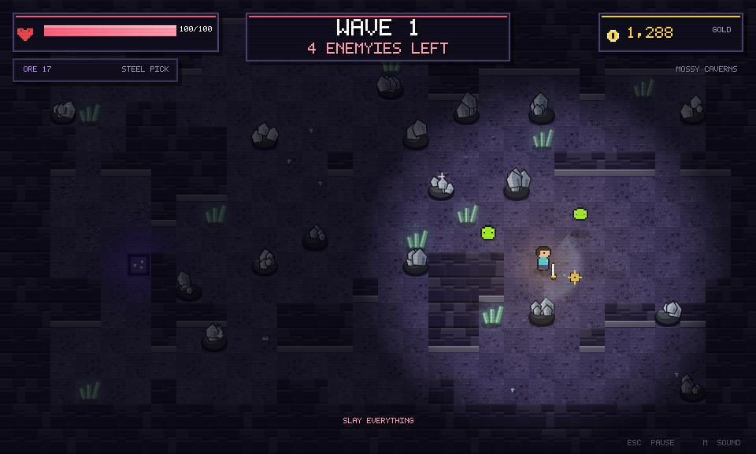

# Deepmine

A 2D pixel-art, top-down mine-and-fight wave game. Spawn in a cozy **hub**, gear up at the
**Prospector's shop**, then step through the portal into a procedural cave where you **mine ore**
for gold before each wave of mobs attacks.



## Run it

```bash
node server.js       # or: npm start
# open http://localhost:3000
```

No build step and no runtime dependencies — plain ES modules served by a tiny static server.
Everything (sprites, font, sound) is generated in code.

## How it plays

**The Hub**
- Walk with `WASD` / arrow keys (or hold the mouse button to walk toward the cursor).
- Click the shopkeeper or the counter (or press `B`) to open the shop.
- Step onto the glowing portal and press `E`, or hit **ENTER THE MINE**.

**The Shop — "The Prospector"**
- **Pickaxes** (9 tiers): higher power breaks ore faster, higher gold multiplier increases payout.
- **Swords** (8 tiers): damage per swing, straight DPS upgrades.
- **Supplies**: health potions, +max HP, movement speed, lantern radius and crit chance.

**The Mine**
- Every wave starts with a **mining phase** (~22s): hold the mouse (or `SPACE`) on a glowing ore
  cluster to chip it. Ore that breaks drops coins that magnet toward you.
- Press `F` (or **FIGHT NOW**) when prepared — or let the timer run out and the wave starts anyway.
- Mobs spawn out of the dark and path to you. Clear them all to finish the wave.
- Wave clear = gold bonus + a heal, then the next wave begins in the same cave with fresh ore.
- Every 5th wave is a **boss wave** (Skeleton King: ground slams, charges, summons).
- The biome re-skins the cave every 5 waves: Mossy Caverns → Frozen Hollow → Ashen Depths →
  Amethyst Rift → Gilded Vault.

**Risk and reward**
- The portal in the spawn room (`E`) ends the run and banks everything you earned.
- **Dying costs half the gold from that run** — owned gear and wallet gold are safe. Keep digging,
  or get out while you're ahead.

## Controls

| Input | Action |
| --- | --- |
| `WASD` / arrows | Move |
| Hold left click | Attack toward cursor / mine ore |
| `SPACE` / `J` | Attack or mine (keyboard alternative) |
| `E` | Use portal (enter or leave the mine) |
| `F` | Start the wave immediately |
| `B` | Open the shop |
| `ESC` | Pause (in the mine) / leave the shop |
| `M` | Mute/unmute |

## Content

- 6 enemy types: slime (hops), cave bat (swoops), skeleton (chases), wraith (ranged bolts),
  stone golem (telegraphed charge), skeleton king (boss).
- 7 ore types gated by wave: coal, iron, gold, emerald, diamond, amethyst, starstone.
- 9 pickaxes, 8 swords, 5 stacking upgrades.
- Procedural caves: jittered room grid, blobby caverns, winding corridors and guaranteed
  connectivity. Ore and mob spawns are restricted to the region reachable from your spawn.
- Mobs use a BFS flow field to path around walls, plus an anti-stall failsafe so a wave can
  always be finished.
- Save data (gold, gear, upgrades, best wave, stats) persists in `localStorage`.

## Project layout

```
index.html          page shell + canvas
server.js           zero-dependency static server (binds 0.0.0.0)
src/main.js         boot, resize/scaling, game loop
src/game.js         state machine, combat, waves, shop and all UI screens
src/world.js        hub + procedural cave generation, collision, flow-field pathing
src/render.js       tile/prop/ore rendering, lighting, vignette
src/sprites.js      character-matrix art -> canvases, sprite drawing helpers
src/art.js          every sprite as a string matrix + palette
src/font.js         5x7 bitmap font and text helpers
src/ui.js           immediate-mode pixel buttons/panels
src/audio.js        procedural WebAudio sound effects
src/save.js         localStorage save/load with validation
```

## Dev tools

```bash
npm test          # art validation + headless playthrough smoke test
npm run shots     # render PNG screenshots of every screen (needs @napi-rs/canvas)
```

`npm test` drives the real game headlessly through title → hub → shop purchases → mine → mining →
waves → boss wave → pause → death → summary → hub and fails on runtime errors, NaN geometry,
escaped players or stuck waves. The `shots/` folder was produced by `npm run shots`.
